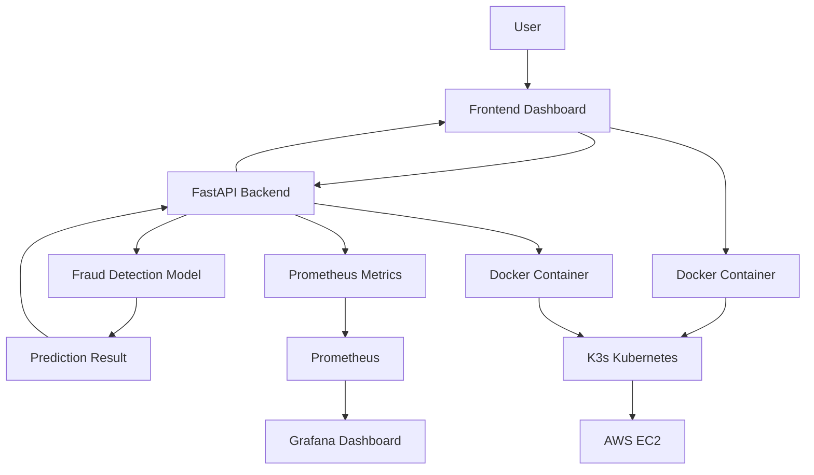

# Sentinel Risk Engine

**Real-Time Fraud Detection System with Machine Learning, FastAPI, Kubernetes, and Monitoring**

Sentinel Risk Engine is an end-to-end fraud detection system designed to identify potentially fraudulent financial transactions using machine learning. It combines a trained fraud detection model with a REST API, interactive frontend, containerization, Kubernetes deployment, and monitoring infrastructure.

The system provides real-time fraud predictions while tracking API health, request metrics, errors, and latency through Prometheus and Grafana.

---

## 🚀 Live Demo

- **Frontend Dashboard:** http://54.159.70.212:30090
- **Backend API:** http://54.159.70.212:30080
- **API Documentation:** http://54.159.70.212:30080/docs
- **Health Check:** http://54.159.70.212:30080/health

> The deployment runs on AWS EC2 using K3s. The public IP may change if the EC2 instance is stopped and started.

---

## ✨ Highlights

| Feature | Description |
|---|---|
| 🤖 ML Fraud Detection | LightGBM-based fraud prediction model |
| ⚡ Real-Time API | FastAPI REST API for transaction inference |
| 📊 Interactive Dashboard | Frontend for fraud predictions and analytics |
| 🐳 Containerization | Docker-based frontend and backend deployment |
| ☸️ Kubernetes Deployment | Deployment and service management using K3s |
| ☁️ AWS Deployment | Hosted on AWS EC2 |
| 📈 Monitoring | Prometheus metrics collection |
| 📊 Visualization | Grafana monitoring dashboard |
| 🚨 Alerting | Alerts for API availability, error rate, and response time |
| 🔍 Transaction Analysis | Transaction data and fraud analytics |
| 🧪 Model Evaluation | Evaluation using PR-AUC, ROC-AUC, and F1-score |

---

## 🏗️ Architecture

Sentinel follows a modular architecture connecting the machine learning model, backend API, frontend dashboard, container infrastructure, and monitoring system.



### System Components

| Component | Responsibility |
|---|---|
| Frontend | User interface for transaction analysis and fraud prediction |
| FastAPI | Backend API and model inference |
| LightGBM | Fraud classification |
| Docker | Containerization of application services |
| K3s | Kubernetes deployment and orchestration |
| AWS EC2 | Cloud hosting infrastructure |
| Prometheus | Metrics collection and monitoring |
| Grafana | Monitoring dashboards and visualization |

---

## 🔄 Workflow

The system follows this workflow when a transaction is submitted:

```text
User
 │
 ▼
Frontend Dashboard
 │
 ▼
FastAPI Backend
 │
 ▼
Feature Processing
 │
 ▼
LightGBM Fraud Model
 │
 ▼
Fraud Probability
 │
 ▼
Threshold-Based Classification
 │
 ▼
Prediction Result
 │
 ▼
Frontend Dashboard
```

### Prediction Workflow

1. The user enters transaction details through the frontend.
2. The frontend sends the transaction data to the backend API.
3. The backend validates and prepares the input features.
4. The trained LightGBM model generates a fraud probability.
5. The probability is compared against the configured decision threshold.
6. The transaction is classified as fraudulent or legitimate.
7. The prediction and probability are returned to the frontend.

---

## 🤖 Machine Learning Model

Sentinel uses a **LightGBM classification model** for fraud detection.

The model is trained on transaction data with engineered features designed to improve fraud identification.

### Model Configuration

| Parameter | Value |
|---|---|
| Model | LightGBM |
| Task | Binary Classification |
| Feature Count | 13 engineered features |
| Decision Threshold | 0.96 |
| Target | Fraudulent / Legitimate Transaction |

### Model Evaluation

The model was evaluated on a held-out test dataset.

| Metric | Score |
|---|---:|
| PR-AUC | **0.883** |
| ROC-AUC | **0.997** |
| F1-Score | **0.802** |

> These metrics represent offline evaluation on a held-out test dataset, not live production performance.

### Why PR-AUC?

Fraud detection datasets are generally highly imbalanced, with legitimate transactions significantly outnumbering fraudulent transactions.

PR-AUC provides a more informative evaluation of fraud detection performance under class imbalance because it focuses on the relationship between precision and recall for the fraud class.

---

## 📊 Monitoring & Observability

Sentinel integrates Prometheus and Grafana to monitor application health and API performance.

### Monitoring Stack

| Tool | Purpose |
|---|---|
| Prometheus | Collects and stores metrics |
| Grafana | Visualizes monitoring data |
| FastAPI | Exposes application metrics |
| Kubernetes | Runs the application and monitoring services |

### Grafana Dashboard

The monitoring dashboard contains **13 panels** covering application and API metrics.

Monitoring includes:

- API availability
- Request metrics
- Request rate
- API error rate
- Response time
- P95 latency
- Application health
- Monitoring infrastructure

### Alert Rules

The system includes 3 alert rules:

| Alert | Condition |
|---|---|
| Sentinel API Down | API availability falls below 1 |
| High API Error Rate | Error rate exceeds 0.05 errors/second |
| High API Response Time | P95 response time exceeds 1 second |

---

## ☸️ Deployment Architecture

Sentinel is deployed using Docker containers and Kubernetes on AWS EC2.

```text
                   AWS EC2
                     │
                     ▼
                    K3s
                     │
        ┌────────────┴────────────┐
        │                         │
        ▼                         ▼
Frontend Deployment         API Deployment
        │                         │
        ▼                         ▼
Frontend Service            API Service
        │                         │
        │                         ├── Fraud Model
        │                         ├── FastAPI
        │                         └── Metrics
        │
        └──────────────┐
                       │
                       ▼
              Monitoring Stack
                       │
              ┌────────┴────────┐
              ▼                 ▼
          Prometheus         Grafana
```

### Deployment Technologies

- Docker
- Docker Hub
- Kubernetes
- K3s
- AWS EC2
- NodePort Services
- Persistent Volume Claims

---

## 🔌 API

Sentinel exposes REST API endpoints through FastAPI.

### API Documentation

FastAPI automatically generates interactive API documentation.

```text
/docs
```

### Health Check

```http
GET /health
```

Example response:

```json
{
  "status": "healthy",
  "service": "Sentinel Risk Engine",
  "version": "1.0.0"
}
```

### Metrics

```http
GET /metrics
```

The endpoint exposes metrics that can be scraped by Prometheus.

---

## 💻 Tech Stack

| Layer | Technology |
|---|---|
| Programming Language | Python |
| Machine Learning | LightGBM |
| Backend | FastAPI |
| Frontend | React / Vite |
| API Communication | REST API |
| Containerization | Docker |
| Container Registry | Docker Hub |
| Orchestration | Kubernetes / K3s |
| Cloud | AWS EC2 |
| Monitoring | Prometheus |
| Visualization | Grafana |
| Version Control | Git / GitHub |

---

## 🚀 Getting Started

### Prerequisites

- Python 3.10+
- Docker
- Git
- Node.js and npm
- AWS account (for cloud deployment)

---

### 1. Clone the Repository

```bash
git clone https://github.com/YOUR_USERNAME/Sentinel-risk-engine.git
cd Sentinel-risk-engine
```

---

### 2. Create a Python Virtual Environment

#### Windows

```powershell
python -m venv .venv
.venv\Scripts\activate
```

#### Linux / macOS

```bash
python -m venv .venv
source .venv/bin/activate
```

---

### 3. Install Backend Dependencies

```bash
pip install -r requirements.txt
```

---

### 4. Run the Backend

Start the FastAPI application using the appropriate application entry point.

Example:

```bash
uvicorn src.api.main:app --host 0.0.0.0 --port 8000
```

Backend API:

```text
http://localhost:8000
```

Swagger documentation:

```text
http://localhost:8000/docs
```

Health endpoint:

```text
http://localhost:8000/health
```

---

### 5. Run the Frontend

Navigate to the frontend directory:

```bash
cd frontend
```

Install dependencies:

```bash
npm install
```

Start the development server:

```bash
npm run dev
```

The frontend development server will provide a local URL, typically:

```text
http://localhost:5173
```

---

## 🐳 Docker

Sentinel uses Docker to package the frontend and backend services.

### Backend Image

```bash
docker build -t sentinel-risk-engine .
```

Run the backend:

```bash
docker run -p 8000:8000 sentinel-risk-engine
```

### Frontend Image

Navigate to the frontend directory:

```bash
cd frontend
```

Build the image:

```bash
docker build -t sentinel-frontend .
```

Run the frontend:

```bash
docker run -p 3000:80 sentinel-frontend
```

---

## ☸️ Kubernetes Deployment

The application is deployed on a K3s Kubernetes cluster running on AWS EC2.

### Main Kubernetes Components

| Component | Description |
|---|---|
| `sentinel-api` | Backend API deployment |
| `sentinel-frontend` | Frontend deployment |
| API Service | Exposes backend API |
| Frontend Service | Exposes frontend |
| Persistent Volume Claim | Persistent storage for application data |
| Prometheus | Metrics collection |
| Grafana | Monitoring dashboards |

### Deployment Management

Check deployments:

```bash
kubectl get deployments
```

Check pods:

```bash
kubectl get pods
```

Check services:

```bash
kubectl get services
```

Check deployment rollout:

```bash
kubectl rollout status deployment/sentinel-api
```

Restart a deployment:

```bash
kubectl rollout restart deployment/sentinel-api
```

---

## 📈 MLOps & Monitoring

Sentinel incorporates deployment and monitoring practices to make the fraud detection application observable after deployment.

### Monitoring Workflow

```text
Application
    │
    ▼
Metrics Endpoint
    │
    ▼
Prometheus
    │
    ▼
Metrics Storage & Query
    │
    ▼
Grafana Dashboard
    │
    ▼
Alerts & Monitoring
```

This setup helps monitor the operational health of the application independently of the model's offline evaluation metrics.

---

## 📁 Project Structure

```text
Sentinel-risk-engine/
│
├── frontend/
│   ├── src/
│   ├── public/
│   ├── Dockerfile
│   └── package.json
│
├── src/
│   ├── api/
│   │   └── main.py
│   ├── ...
│
├── deployment/
│   └── kubernetes/
│
├── monitoring/
│   ├── prometheus/
│   └── grafana/
│
├── tests/
│
├── Dockerfile
├── requirements.txt
├── .gitignore
└── README.md
```

> Update the project structure above to match the exact directory structure of the repository.

---

## 🧪 Testing

Run the project's tests using:

```bash
pytest
```

The test suite helps validate components of the application and maintain reliability during development.

---

## 🔐 Security Notes

- Never commit API keys, credentials, or private configuration files.
- Use environment variables for sensitive configuration.
- Avoid exposing unnecessary AWS ports.
- Restrict SSH access to trusted IP addresses.
- Do not expose Kubernetes administration ports publicly.
- Review Docker images and dependencies regularly.
- Protect monitoring interfaces with appropriate access controls.

---

## 🎯 Project Objectives

Sentinel Risk Engine aims to combine machine learning with production-oriented deployment practices.

The project focuses on:

- Detecting potentially fraudulent transactions
- Serving machine learning predictions through REST APIs
- Containerizing services
- Deploying applications with Kubernetes
- Hosting applications on cloud infrastructure
- Monitoring application availability and performance
- Building an end-to-end ML deployment workflow

---

## 🔮 Future Improvements

Potential extensions include:

- Real-time transaction streaming
- Advanced transaction velocity features
- Model drift detection
- Automated model retraining
- ML model versioning
- CI/CD deployment pipelines
- Authentication and authorization
- Improved alert notification integration
- Horizontal pod autoscaling
- Centralized logging
- Model performance monitoring using live feedback

---

## 👨‍💻 Author

**Krishna Kumar Gupta**

Computer Science Engineering Student | Machine Learning | AI | MLOps

---

⭐ If you find this project interesting, feel free to explore the repository and give it a star.
